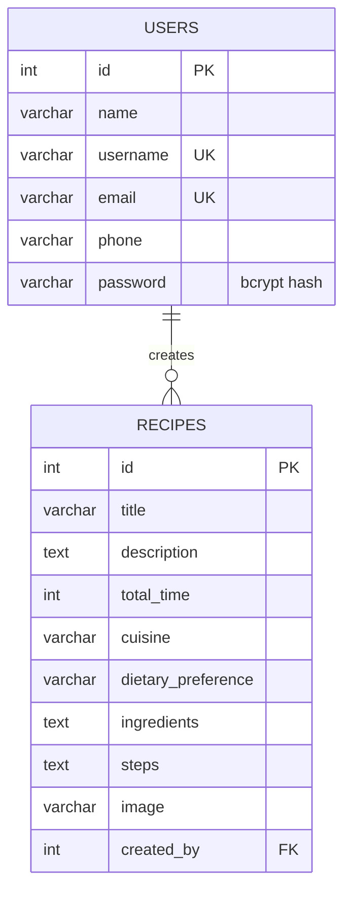

# CuisineCollective

A full-stack recipe-sharing web app. Users sign up, publish recipes with photos, and search and browse what others have shared.


## Features

- **Accounts:** registration and sign-in with server-side sessions. Passwords are hashed with `password_hash()` (bcrypt) and checked with `password_verify()`.
- **Recipe publishing:** title, description, cuisine, dietary preference, total time, ingredients, steps and an uploaded photo.
- **Search:** filter recipes by name, ingredient, cuisine or dietary preference.
- **Recipe pages:** a detail view for each recipe with its image, ingredients and steps, and an option to remove it.
- **Session-aware navigation:** the menu changes for signed-in users, the dashboard redirects guests to sign-in, and new recipes are linked to their author.
- **Client-side validation:** each form validates input in JavaScript before it is submitted, and the server validates it again.
- **Safe database access:** queries that take user input use `mysqli` prepared statements, and the searchable columns are whitelisted, which protects against SQL injection.
- **Zero-setup database:** on first run the app creates the `recipe_manager` database and tables from `sql/schema.sql` automatically.
- **Responsive layout** for desktop and mobile.

## Tech stack

| Layer | Technology |
|---|---|
| Back end | PHP 8 (procedural pages + a small DAO class) |
| Database | MySQL / MariaDB via `mysqli` |
| Front end | HTML5, CSS3, vanilla JavaScript |

## Getting started

1. Install a local PHP + MySQL stack such as [XAMPP](https://www.apachefriends.org/).
2. Clone the repository into your web root (for XAMPP, `htdocs/`):
   ```bash
   git clone https://github.com/Amin-nekouei/CuisineCollective.git
   ```
3. Check the connection settings in `dao/database.php` (and the matching block in `new_recipe.php`). The defaults are user `root`, no password, port `3308`; XAMPP's default MySQL port is `3306`.
4. Start Apache and MySQL, then open `http://localhost/CuisineCollective/`. The database is created automatically on the first visit.

## Project structure

```
├── index.php            # Home page: browse and search recipes
├── registration.php     # Sign up
├── signin.php / logout.php
├── dashboard.php        # Signed-in landing page
├── new_recipe.php       # Create a recipe (with image upload)
├── recipe.php           # Recipe detail page
├── header.php           # Shared navigation
├── dao/
│   ├── database.php     # Connection + automatic schema setup
│   └── RecipeManager.php# Recipe queries (get / delete)
├── sql/schema.sql       # Database schema
├── scripts/             # Form validation and page scripts
├── css/  images/  uploads/
```

## Database schema



## What I learned

- Building session-based authentication in PHP and storing passwords safely.
- Using prepared statements and column whitelists to keep user input out of SQL.
- Handling file uploads and generating unique file names to avoid collisions.
- Validating the same rules on both the client and the server.

## Author

**Amin Nekouei** · [LinkedIn](https://www.linkedin.com/in/amin-nekouei) · [GitHub](https://github.com/Amin-nekouei)
